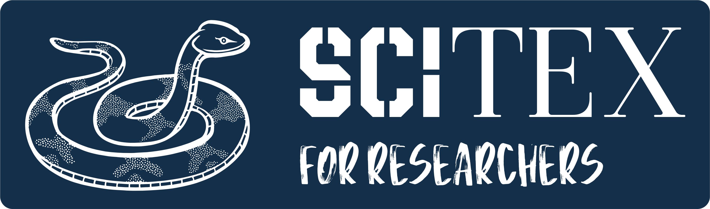
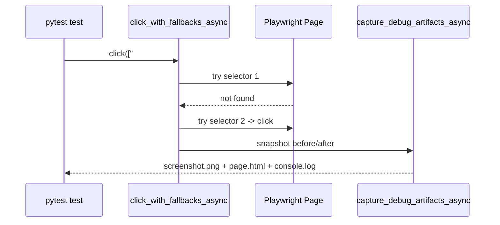
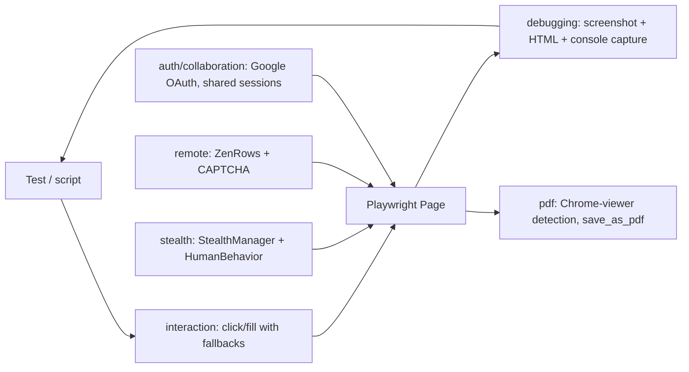

# scitex-browser

<p align="center">
  <a href="https://scitex.ai">
    
  </a>
</p>

<p align="center"><b>Playwright wrappers for scholarly paper access — popup handling, PDF capture, failure-replay screenshots, stealth browsing.</b></p>

<p align="center">
  <a href="https://scitex-browser.readthedocs.io/">Full Documentation</a> · <code>uv pip install scitex-browser[all]</code>
</p>

<!-- scitex-badges:start -->
<p align="center">
  <a href="https://pypi.org/project/scitex-browser/"></a>
  <a href="https://pypi.org/project/scitex-browser/"></a>
  <a href="https://scitex-browser.readthedocs.io/en/latest/"></a>
</p>
<p align="center">
  <a href="https://github.com/ywatanabe1989/scitex-browser/actions/workflows/ci.yml"></a>
  <a href="https://codecov.io/gh/ywatanabe1989/scitex-browser"></a>
</p>
<!-- scitex-badges:end -->

---

## Problem and Solution

| # | Problem | Solution |
|---|---------|----------|
| 1 | **Playwright is great but verbose** -- every scraping script reinvents popup dismissal, retry logic, Chrome-PDF-viewer workaround | **Helpers**: `click_with_fallbacks_async([sel1, sel2])`, `save_as_pdf_async`, `close_popups_async`, `inject_visual_effects` — focused wrappers around Playwright |
| 2 | **Silent test failures** -- `pytest-playwright` doesn't auto-capture screen + DOM on failure | **`TestMonitor`** -- captures screenshot + page HTML + console log on every failure (`create_failure_capture_fixture`) |

## Features

- **Debugging**: Visual cursor feedback, popup logging, failure capture, test monitoring
- **PDF**: Chrome PDF viewer detection, save-as-PDF automation
- **Interaction**: Click/fill with fallbacks, popup handling
- **Stealth**: Human-like behavior simulation, stealth browser management
- **Remote**: ZenRows API integration, CAPTCHA handling
- **Collaboration**: Shared browser sessions, credential management
- **Auth**: Google authentication helpers

## Quick start

```python
from scitex_browser import save_as_pdf, browser_logger
from scitex_browser.stealth import StealthManager
```

## Demo



<p align="center"><sub><b>Figure 1.</b> Failure-aware click flow: every fallback attempt runs against the Playwright page while the debugging layer snapshots screenshot, HTML, and console output for replay.</sub></p>

## Installation

```bash
uv pip install "scitex-browser[all]"
```

<details>
<summary><b>Per-module extras</b></summary>

<br>

| Extra | Pulls in |
|---|---|
| `dev` | pytest, pytest-cov, pytest-asyncio, scitex-dev (test suite + audit tooling) |
| `docs` | Sphinx + RTD theme + myst-parser (docs build only) |
| `all` | `dev` + `docs` (recommended) |

```bash
uv pip install "scitex-browser[dev]"    # test suite + audit tooling
uv pip install "scitex-browser[docs]"   # docs build only
uv pip install -e ".[all]"              # editable install for contributors
```

</details>

## Architecture



<p align="center"><sub><b>Figure 2.</b> Module workflow: every automation path drives a Playwright page (hardened by stealth/remote/auth layers) while the debugging and pdf layers capture artifacts back to the caller.</sub></p>

## 1 Interfaces

<details open>
<summary><strong>Python API</strong></summary>

<br>

```python
from scitex_browser import (
    save_as_pdf, save_as_pdf_async,
    click_with_fallbacks_async, close_popups_async,
    inject_visual_effects, browser_logger,
)
from scitex_browser.stealth import StealthManager
from scitex_browser.debugging import (
    TestMonitor, create_failure_capture_fixture,
    capture_debug_artifacts_async,        # screenshot + HTML (via .debugging)
)
```

`click_with_fallbacks_async` and `fill_with_fallbacks_async` capture
screenshot + HTML before/after every call by default
(`capture_debug=True`). Drop `capture_debug=False` only in tight
loops. See `_skills/scitex-browser/11_debugging-visuals.md` for the
full pattern.

</details>

## Part of SciTeX

`scitex-browser` is part of [**SciTeX**](https://scitex.ai). Install via
the umbrella with `pip install scitex[browser]` to use as
`scitex.browser` (Python) or `scitex browser ...` (CLI).

>Four Freedoms for Research
>
>0. The freedom to **run** your research anywhere — your machine, your terms.
>1. The freedom to **study** how every step works — from raw data to final manuscript.
>2. The freedom to **redistribute** your workflows, not just your papers.
>3. The freedom to **modify** any module and share improvements with the community.
>
>AGPL-3.0 — because we believe research infrastructure deserves the same freedoms as the software it runs on.

## License

AGPL-3.0. See [LICENSE](LICENSE) for details.

---

<p align="center">
  <a href="https://scitex.ai" target="_blank"></a>
</p>
